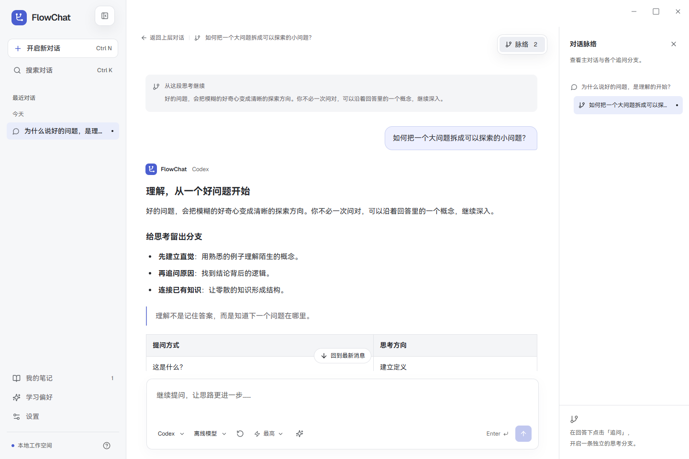

# FlowChat

### 让好奇心长出分支。

一个为深入思考而设计的 AI 对话桌面应用。 
随时追问、自由探索，再带着收获回到主线。

[下载 Windows 版](https://github.com/TaiRuiQu/flowchat/releases/latest) · [快速上手](#几步开始你的第一次探索) · [反馈与建议](https://github.com/TaiRuiQu/flowchat/issues)

实际应用界面，使用离线演示内容。

## 一个好问题，往往不止一个方向

读到一个陌生概念，想停下来弄懂；看到一个有趣的观点，想换个角度验证；研究到一半，又冒出新的问题。

FlowChat 为这些时刻留出了空间：从任意回答开启分支，沿着新的方向继续聊。原来的思路仍在原处，随时可以回来接着走。

## 沿着回答，走得更深

### 想追问，就从这里开始

点击回答下的「追问」，开启一条独立分支。也可以先选中一句话，带着引用继续问，让关注点更明确。每条分支保留起点之前的上下文，各自展开。

### 思路展开了，来路依然清楚

打开「脉络」，查看主对话与追问分支，在不同方向间切换。探索告一段落，点击「返回上层对话」，回到问题的来源。

### 把值得留下的回答，变成自己的笔记

收藏一段回答，继续用 Markdown 整理、补充和改写。笔记保留来源入口，回看时可以接着当时的思考继续聊，也可以独立新建笔记，记录自己的理解。

### 用熟悉的工具，保持自己的节奏

在同一处切换 Codex、Claude Code 和 OpenCode，选择可用模型。FlowChat 会分别记住各工具的模型选择；支持思考强度的模型还可以按需调整。写下你的学习偏好，让后续交流更贴近你习惯的解释方式。

## 给阅读和思考，一个舒服的空间

- **公式、代码、表格，都好读。** 支持 Markdown、LaTeX 数学公式和代码高亮，适合学习概念、阅读推导与讨论实现。
- **白天与深夜，各有合适的光线。** 浅色、深色或跟随系统，搭配可调宽度的侧栏与适应窄窗口的布局。
- **暂时离开，回来接着想。** 草稿自动保存，对话可搜索，重要内容可导出为 Markdown。
- **你的内容，留在自己的电脑上。** 对话、笔记与设置保存在本地，数据目录可从设置直接打开。

## 适合这样的你

| 当你正在……       | 用 FlowChat……                                |
| ---------------- | -------------------------------------------- |
| 自学一门新知识   | 从定义追到例子、推导和应用，每个疑问单独展开 |
| 深读一个复杂观点 | 引用关键句继续问，把不同角度留在各自的分支里 |
| 推敲方案或代码   | 沿着备选思路探索，再回到主线继续比较         |
| 整理学习收获     | 把回答存成笔记，加上自己的理解，随时回到来源 |

## 几步开始你的第一次探索

1. 从 [Releases](https://github.com/TaiRuiQu/flowchat/releases/latest) 下载 Windows x64 安装包，或下载便携版并完整解压。
2. 在本机安装并登录至少一个受支持的工具：Codex、Claude Code 或 OpenCode。已有登录可以继续使用。
3. 打开 FlowChat，在「设置」中检查工具；如果没有自动找到，手动指定工具路径。
4. 选择工具和模型，输入第一个问题。读到想深入的地方，点击「追问」。

**试着从一个具体的问题开始：**「用生活中的例子解释贝叶斯定理。」再选中回答里感兴趣的一句话，沿着它继续探索。

当前提供 Windows x64 版本，仍在持续迭代。安装包暂未进行代码签名，Windows 可能显示发布者提示；请核对下载来源与 Release 附带的 SHA-256 校验值。

## 你可能关心

**需要另外配置 API Key 吗？**

FlowChat 使用本机工具自己的登录与配置，不代管 API 密钥，也不内置模型服务。模型的可用性、费用和使用额度由所选工具及供应商决定。

**内容会上传到哪里？**

FlowChat 没有云同步，工作空间保存在本机。发送问题时，所选工具会将请求发送至对应模型供应商。工作空间文件以明文保存，请按需备份并保护设备。

**可以离线使用吗？**

可以离线查看已保存的对话和整理笔记。生成新回答取决于所选工具与模型的网络要求。

**如何反馈问题或参与开发？**

欢迎在 [Issues](https://github.com/TaiRuiQu/flowchat/issues) 分享遇到的问题和希望改进的体验。开发、构建与测试说明见 [开发指南](docs/DEVELOPMENT.md)。

## 开源与致谢

FlowChat 项目代码采用 [MIT 协议](LICENSE)，欢迎使用、修改和参与改进。

界面使用 Geist 与 HarmonyOS Sans SC 字体。字体及其他第三方组件保留各自的许可证，详见 [第三方声明](THIRD_PARTY.md)。
